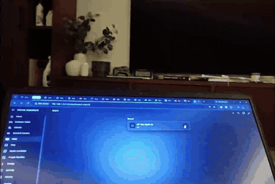
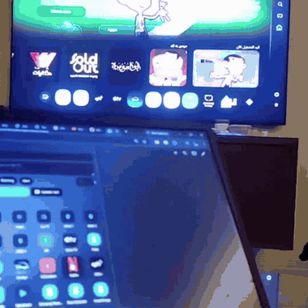
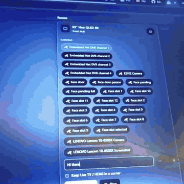
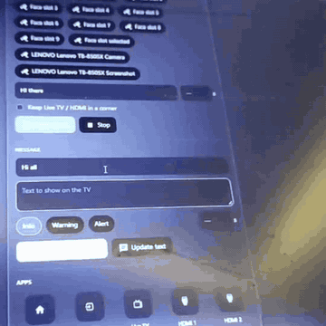
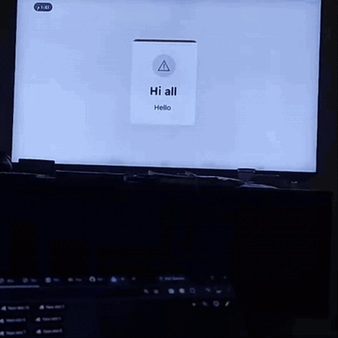
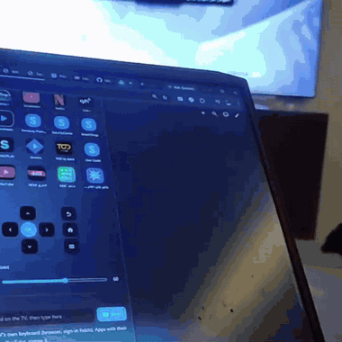
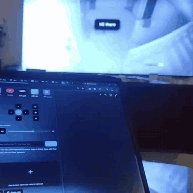

<p align="center">
  
</p>

<h1 align="center">Samstream</h1>

<p align="center">
  <b>Your Samsung TV, fully inside Home Assistant.</b><br>
  Cameras on the big screen, native TV notifications, live full-screen messages, a touchpad,<br>
  Frame art and app-aware automations, with optional local OCF control and no cloud.
</p>

<p align="center">
  <a href="https://github.com/hacs/integration"></a>
  <a href="https://github.com/Mrslimon/samstream/releases/latest"></a>
  <a href="LICENSE"></a>
</p>

<p align="center">
  <a href="https://my.home-assistant.io/redirect/hacs_repository/?owner=Mrslimon&repository=samstream&category=integration"></a>
</p>

<table>
  <tr>
    <th width="50%">⚡ Turn the TV on from Home Assistant</th>
    <th width="50%">🍿 Open Netflix, the lights go cinema</th>
  </tr>
  <tr>
    <td align="center"></td>
    <td align="center"></td>
  </tr>
</table>

## Table of contents

- [Why Samstream](#why-samstream)
- [See it in action](#see-it-in-action)
- [Installation](#installation)
- [Supported devices](#supported-devices)
- [Configuration](#configuration)
- [Entities](#entities)
- [Actions](#actions)
- [More ideas](#more-ideas)
- [Removing a TV](#removing-a-tv)
- [Data updates](#data-updates)
- [Known limitations](#known-limitations)
- [Troubleshooting](#troubleshooting)
- [Changelog](#changelog)
- [Development](#development)
- [Credits](#credits)
- [License](#license)

## Why Samstream

Samstream is more than a remote: it puts things **on** the screen. It ships its own signed Tizen app, installed for you by Home Assistant, and hands the
TV back to what you were watching when it is done.

| | Samstream | [Samsung Smart TV](https://www.home-assistant.io/integrations/samsungtv/) (built in) | [SamsungTV Smart](https://github.com/ollo69/ha-samsungtv-smart) | [TheFab21 fork](https://github.com/TheFab21/ha-samsungtv-smart) |
|---|:---:|:---:|:---:|:---:|
| Power, volume, keys, app launching | ✅ | ✅ | ✅ | ✅ |
| Home Assistant as the TV's local OCF (SmartThings protocol) endpoint | ✅ | – | – | – |
| Live **camera streams** on the TV | ✅ | – | – | – |
| **Full-screen messages**, with text you can update live | ✅ | – | – | – |
| **Native TV notification** with your own text | ✅ | – | – | – |
| **Return** to what was playing afterwards | ✅ | – | – | – |
| **Touchpad** / pointer control | ✅ | – | – | – |
| Know which app is on screen | ✅ | – | ✅ | ✅ |
| Open web links and YouTube videos | ✅ | – | ✅ | partial |
| Frame art from HA | list, show, upload, crop, mattes | – | on/off | list, upload, mattes, slideshow, brightness |

<sub>✅ documented by the project · – not found in its documentation. Based on each project's own
README or docs page, checked November 2026. Something out of date? Please open an issue.</sub>

### The local part

SmartThings controls Samsung TVs over **OCF**. We reverse engineered the TV's side of it so
that **Home Assistant itself is the endpoint the TV connects to**: the app on screen, the input
and power changes are pushed the moment they happen, without Samsung's cloud.

It is optional, and it has one trade-off: while it is on, the SmartThings app cannot control
that TV. One click releases the TV back to SmartThings. Everything else in Samstream works
without it.

## See it in action

### 📹 Any Home Assistant camera, on your TV

Samsung TVs do not take your camera streams by themselves. Samstream's TV app does: pick a
camera, add a line of text, and the TV shows it, then goes back to what was playing. It turns
the TV on first if needed.

<p align="center"></p>

```yaml
automation:
  - alias: "Doorbell camera on the living room TV"
    triggers:
      - trigger: state
        entity_id: binary_sensor.front_door_motion
        to: "on"
    actions:
      - action: samstream.play_stream
        target:
          entity_id: media_player.living_room_tv
        data:
          camera: camera.front_door
          label: "Front door"
          message: "Someone is at the door"
          duration: 30
```

### 🚨 Full-screen messages you can rewrite while they are showing

Info, warning, alert or success cards, with a chime or text-to-speech. Change the text as often
as you like without reloading anything: show "Someone is at the door" now, and the AI
description of the visitor when it arrives.

<table>
  <tr>
    <th width="50%">Show it</th>
    <th width="50%">Update it live</th>
  </tr>
  <tr>
    <td align="center"></td>
    <td align="center"></td>
  </tr>
</table>

```yaml
actions:
  - action: samstream.show_message
    target:
      entity_id: media_player.living_room_tv
    data:
      title: "Front door"
      message: "Someone is at the door"
      severity: warning
      duration: 60
      return_to_previous: true   # reopen and resume what was playing
  - delay: "00:00:05"            # ...your AI analysis runs here
  - action: samstream.update_message
    target:
      entity_id: media_player.living_room_tv
    data:
      message: "A courier is holding a parcel"
```

The same `update_message` changes the text over a camera too.

### 🔔 Native Samsung notifications

Samsung's own corner popup, with its chime, drawn **over whatever is playing**. Nothing pauses,
nothing closes.

```yaml
actions:
  - action: samstream.show_notification
    target:
      entity_id: media_player.living_room_tv
    data:
      title: "Washing machine"
      message: "The laundry is done"
    continue_on_error: true   # a TV that is off must not stop the automation
```

The TV must be on, and the Samstream app must have been opened once since the TV last
restarted. If you would rather always get *something* on screen, use `notify.send_message` on
the TV's notify entity: it sends the native notification and falls back to a short full-screen
message.

### 🎬 Automations that know what you are watching

`sensor.<tv>_current_app` names the app on screen. Start Netflix and the room becomes a cinema;
leave it and the lights come back.

```yaml
automation:
  - alias: "Cinema mode"
    triggers:
      - trigger: state
        entity_id: sensor.living_room_tv_current_app
        to: "Netflix"
    actions:
      - action: light.turn_off
        target:
          area_id: living_room

  - alias: "Lights back after Netflix"
    triggers:
      - trigger: state
        entity_id: sensor.living_room_tv_current_app
        from: "Netflix"
    actions:
      - action: light.turn_on
        target:
          area_id: living_room

  - alias: "TV muted: bring up a soft light"
    triggers:
      - trigger: state
        entity_id: media_player.living_room_tv
        attribute: is_volume_muted
        to: true
    actions:
      - action: light.turn_on
        target:
          entity_id: light.living_room_lamp
        data:
          brightness_pct: 20
```

It works the other way too: open any installed app from a script, a button, a voice command or
the card.

```yaml
actions:
  - action: samstream.launch_app
    target:
      entity_id: media_player.living_room_tv
    data:
      app_id: "3201907018807"   # Netflix
```

### 🎮 A real remote and a touchpad

The dashboard card has the D-pad, OK, Back, Home, Menu, volume, mute, every installed app with
its logo, typing (Arabic included) and a touchpad that moves the TV's pointer. Show only the
parts you want, in any order.

<table>
  <tr>
    <th width="50%">Remote</th>
    <th width="50%">Touchpad pointer</th>
  </tr>
  <tr>
    <td align="center"></td>
    <td align="center"></td>
  </tr>
</table>

Add it from the dashboard's card picker (**Samstream**), or as `type: custom:samstream-card`.

### 🔗 Send links to the TV

A YouTube link plays that video in the TV's own YouTube app (Home Assistant needs internet for
this). Any other link opens in the TV's browser.

```yaml
actions:
  - action: samstream.open_url
    target:
      entity_id: media_player.living_room_tv
    data:
      url: "https://www.youtube.com/watch?v=dQw4w9WgXcQ"
```

Your own videos play too: pick anything from Home Assistant's media library.

### 🖼️ The Frame: your art, your frame

- Browse the artwork stored on the TV, with thumbnails, and show any piece.
- Upload your own picture from Home Assistant: drag to crop, zoom, pick the border (matte)
  style and colour, and preview it before it reaches the TV.
- Change the border of a stored artwork, toggle Art Mode, and schedule it all.

```yaml
actions:
  - action: samstream.upload_art
    target:
      entity_id: media_player.frame_tv
    data:
      path: "www/art/sunset.jpg"
      show: true
  - action: samstream.select_art
    target:
      entity_id: media_player.frame_tv
    data:
      content_id: "MY_F0003"
      matte: "shadowbox_sand"
```

### And more

- ↩️ **Seamless takeover.** Samstream pauses what you were watching, shows the camera or
  message, then reopens the app and resumes it, or switches the TV off again if it was off.
- 🗣️ **Voice bridge.** Each TV can have a webhook; whatever calls it is routed through Assist
  and the answer is shown or spoken.
- 📦 **Easy install and updates.** Home Assistant installs the TV app, signed with your own
  Samsung certificate, and offers new versions as a regular `update` entity.
- 🌍 **English and Arabic**, right to left included.

## Installation

### Marketplace / HACS (recommended)

Samstream is in the default store:

[](https://my.home-assistant.io/redirect/hacs_repository/?owner=Mrslimon&repository=samstream&category=integration)

1. Open **Settings → Marketplace** (Home Assistant 2026.11 or newer), or **HACS** on older
   versions.
2. Search for **Samstream** and select **Download**.
3. Restart Home Assistant.
4. **Settings → Devices & services → Add integration → Samstream.**

If it doesn't show up in search, add it as a custom repository instead:

1. Open the store's **⋮** menu (top right) → **Custom repositories**.
2. Repository: `https://github.com/Mrslimon/samstream`, category **Integration**.
3. Install **Samstream**, then continue with the steps above from the restart.

### Manual

1. Copy `custom_components/samstream` into your Home Assistant `config/custom_components/`
   directory.
2. Restart Home Assistant.
3. **Settings → Devices & services → Add integration → Samstream.**

## Supported devices

Tested on a 2023 QN800C (Tizen 9) and a 2024 Samsung Frame (Tizen 9). Native notifications
have been verified on the QN800C. Samsung Tizen TVs from 2018 on should work; older models
lack some features (notably local control/OCF, which needs the TV's SmartThings service) and
fall back gracefully.

Requirements on the TV:

- **Developer Mode**, so Home Assistant can install the signed TV app over `sdb`.
- A free **Samsung account** sign-in (once per Home Assistant install), to issue the
  certificate the TV app is signed with.
- **Power On with Mobile** (Wake-on-LAN) turned on, if you want Home Assistant to wake a
  sleeping TV.

## Configuration

Everything is set up through the UI; there is no YAML configuration.

**Adding a TV** (config flow):

1. Enter the TV's IP (or let discovery find it).
2. **Developer Mode:** Home Assistant checks whether it can install over `sdb`. If not, it
   shows the exact Developer Mode screen to set, including the host IP to type in, split
   into the four boxes the TV asks for, and reversed if your TV's menu language is
   right-to-left.
3. **Samsung sign-in:** sign in once with a Samsung account so Home Assistant can issue a
   certificate; it covers every Samstream TV afterwards (valid a year, renewed with a
   warning before expiry).
4. The signed Samstream TV app installs automatically.
5. **Local control (optional):** pair the TV for the local, push-based channel. Home
   Assistant tries an on-screen PIN first; if it can't reach the TV directly (e.g. Home
   Assistant in a container without host networking), it offers a small LAN helper to
   download and run once from a computer on the TV's network instead.

**Options** (Configure on an added TV), by section:

| Section | Parameters |
|---|---|
| Network | the TV's IP, Wake-on-LAN target, how often to check the TV |
| App signing | re-run the Samsung sign-in; import/export certificates |
| TV app | extra apps to pin, UI language, theme, auto-update |
| Local control | pair / reconnect / release; port and advertised host, for unusual networks |
| Voice bridge | turn the per-TV webhook on/off, show the reply on the TV |
| Playback | resume playback after a takeover; what "off" means on a Frame (fully off or Art Mode) |

## Entities

One device per TV. `has_entity_name` throughout, so names read as *TV name: entity name*.

| Platform | Entities |
|---|---|
| `media_player` | The TV itself: power, volume, mute, source, app, playback keys. The target for every [action](#actions). |
| `binary_sensor` | Developer Mode, Samstream app installed, Local control connected, TV camera privacy shutter, Energy saving, Motion, and (local control) accessibility toggles: Voice guide, High contrast, Colour inversion, Greyscale |
| `sensor` | Developer host IP, Current app, and (local control) Channel, Ambient light, Sound detected, Remote battery, Wi-Fi signal, Screen orientation |
| `select` | (local control) Input, Picture mode, Sound mode, Sound output, listed by the TV's own names |
| `switch` | Art Mode (Frame, with local control) |
| `button` | Install Samstream app, Download app logos, Return to previous, Guide, Channel list, Sources, Menu, Home screen |
| `update` | Samstream TV app: installed version vs. the one bundled in this integration; `install` updates it in place |
| `notify` | `notify.send_message` shows a native TV notification, or a short full-screen message if the TV cannot take one |

Entities marked *local control* need it paired; without it they stay unavailable rather than
failing.

## Actions

All target a `media_player.*` entity. The full field reference is in Developer Tools → Actions
(or `services.yaml`).

| Action | What it does |
|---|---|
| `samstream.show_notification` | Samsung's own corner notification with a chime, over whatever is playing. |
| `samstream.show_message` | Full-screen info/warning/alert/success card, with a sound (media library chime or TTS) and a duration. |
| `samstream.update_message` | Changes the text shown over a camera or message, without reloading. |
| `samstream.play_stream` | Opens Samstream and plays a camera (turning the TV on first if needed), with an optional message, picture-in-picture corner and duration. |
| `samstream.stop_stream` | Returns to what was on before (reopens and resumes the app, or powers off again). |
| `samstream.launch_app` | Opens an app, or brings it to the front. |
| `samstream.close_app` | Closes an app; the TV returns to what was on screen before. |
| `samstream.open_url` | Opens a link: YouTube links play in the YouTube app, anything else opens in the TV's browser. |
| `samstream.send_keys` | Presses remote keys in sequence (`KEY_HOME`, `KEY_DOWN`, ...). |
| `samstream.hold_key` | Presses and holds one key, for long-press menus or fast seeking. |
| `samstream.send_text` | Types into the TV's on-screen keyboard (open the field first). |
| `samstream.pointer` | Moves the TV's pointer and/or clicks, in apps that show one (the web browser). |
| `samstream.art_mode` | Frame: toggles between normal TV and Art Mode. |
| `samstream.list_art` / `select_art` / `upload_art` | List stored Frame artwork (with thumbnail links, for a dashboard picker), show one by content id, or upload a new image. |
| `samstream.install_app` / `uninstall_app` | Installs/removes the signed Samstream app over Developer Mode; returns the TV's log. |
| `samstream.local_control_request` | Advanced: a raw `get`/`post`/`push`/`reply` against one of the TV's local-control resources. Needs local control on. |

## More ideas

- **Whole-home alerts:** a leak, a smoke alarm or an open door as a full-screen alert with a
  chime or TTS, on every TV at once.
- **Quiet reminders:** laundry done, parcel arrived or dinner ready as a native notification
  that does not interrupt the film.
- **Frame as ambient display:** rotate curated artwork on a schedule, or drop into Art Mode
  once the room goes quiet:

```yaml
automation:
  - alias: "Frame: Art Mode once the living room goes quiet after sunset"
    triggers:
      - trigger: state
        entity_id: binary_sensor.living_room_presence
        to: "off"
        for: "00:10:00"
    conditions:
      - condition: sun
        after: sunset
    actions:
      - action: switch.turn_on
        target:
          entity_id: switch.living_room_frame_art_mode
```

## Removing a TV

Delete the device as usual (**Settings → Devices & services → Samstream → the TV → ⋮ →
Delete**). If local control is paired, Samstream first hands the TV back to SmartThings
(`doxm`/`pstat` ownership release) before the device disappears, so the TV is never left
owned by a Home Assistant that no longer has it configured. If the TV can't be reached at
that moment, removal still proceeds: a **Repairs** entry explains that the release couldn't
be confirmed and what to do (retry while it's awake, or remove it from the SmartThings app).

The same release happens if you just turn local control off from **Configure → Local
control → Remove**, without deleting the device.

## Data updates

- The media player and most sensors check the TV every 10 seconds (power, volume, mute,
  current app); change this from 3 to 300 seconds under **Configure → Network**. The app list
  refreshes every 6 hours, or on demand.
- With **local control** paired, the TV connects to Home Assistant's local OCF endpoint and
  pushes changes as they happen (power, input, app on screen and most diagnostic sensors).
  What it does not push (channel, picture and sound mode) is re-read every 20 seconds. Volume
  and mute still follow the check interval while the TV answers it.
- Camera streams, messages and notifications are sent when an automation calls them.

## Known limitations

Samsung's TVs set some hard limits. Samstream works around what it can; these remain.

**On the TV**

- **Native notifications need a running notifier.** It starts with the Samstream app, so open
  the app once after the TV restarts. Notifications show only while the screen is on.
- **Picture-in-picture only with Live TV and HDMI.** Over Live TV, an HDMI input or Home,
  the camera can play with the TV's own picture kept in a corner (*TV picture in a corner*);
  the camera then shows as fast pictures rather than video, since the TV has one video layer.
  A sideloaded app cannot draw its own windows over Netflix or YouTube, and Samsung's Multi
  View has no API, so over streaming apps Samstream takes the full screen, then hands it back.
- **Playback state is invisible.** The TV does not report whether the app underneath was
  playing or paused. Samstream pauses it and presses Play afterwards; a pause made through
  Home Assistant is remembered, but one made with the TV's own remote is not. Turn off
  *Resume playback afterwards* if that resumes apps you had paused.
- **Live TV and HDMI look like "the last app"** without local control. The TV keeps reporting
  the last app as visible after you switch to Live TV or an input, so going back can reopen
  that app instead of staying on Live TV.
- **Typing needs the TV's own keyboard.** *Type on TV* works in the browser and sign-in
  fields; apps with their own on-screen keyboard (YouTube) ignore it.
- **The pointer needs an app that shows one** (the web browser). Elsewhere a click opens the
  TV's own pointer panel.
- **Camera audio is not played.** Streams are video only (H.264, or H.265 where the TV
  supports it); MJPEG cameras are not supported.
- **Local control depends on the TV's SmartThings service**, which some very old models lack
  or disable; those TVs work with everything except the local-control entities and the
  push-based updates.

**Setup**

- **Developer Mode is required** to install the TV app, and it allows **one** computer: its
  host IP must be Home Assistant's. After turning it on or changing the IP, the TV needs a
  full restart (hold the power button; on The Frame, unplug it for 30 s).
- **Right-to-left menus** (Arabic and others) can store the Developer Mode IP backwards on
  some models; Home Assistant detects this and explains the fix.
- **Samsung certificate:** a free Samsung account sign-in issues it, valid for a year
  (Home Assistant warns before it expires). Each new TV needs one more sign-in; it then
  covers every TV.
- **Waking the TV** needs *Power On with Mobile* (Wake-on-LAN) on the TV. With Home Assistant
  in Docker, discovery and Wake-on-LAN broadcasts may not reach the TV: add the TV by IP and
  set the Wake-on-LAN target under *Configure → Network*.
- **The dashboard card** appears once a TV is added (Home Assistant loads the integration
  only then).
- **App logos** come from each app's public website icon; apps without a known site keep a
  letter tile, and you can add your own image.

## Troubleshooting

- **"The TV did not show the notification":** check the TV is on, open the Samstream app on it
  once, and try again. If it still fails, press **Install Samstream app** on the device page.
- **"Developer Mode needed" keeps showing up:** the host IP in the TV's Developer Mode
  screen must exactly match Home Assistant's LAN address, and the TV needs a full restart
  after you change it (see above). The repair card shown in HA spells out the exact IP and,
  for right-to-left menus, the reversed digits to type.
- **App install fails after adding a new TV to an existing certificate:** the certificate
  only covers TVs it was issued against; re-run **Configure → App signing → Sign in with
  Samsung** to extend it to the new one.
- **Local control won't connect / "not reachable":** Home Assistant must be reachable from
  the TV on the local-control port (default `5684/tcp`). In Docker, publish that port or use
  host networking; a **Repairs** entry names the exact fix for your install type (Container
  vs. Core).
- **Local control was working, then stopped:** open **Configure → Local control** again. A
  TV that reverted to unowned (a factory/network reset, or it was re-added in SmartThings)
  shows as disconnected rather than erroring; pair it again from there.
- **Pairing fails with "no server Finished from the TV", and a power cycle does not fix it:**
  the TV's own local-control security state can get stuck even while it reports no owner; a
  plain restart does not always clear it. Add the TV in the SmartThings app, then remove it
  again right away; that forces a real reset of this state that a power cycle does not. Try
  pairing again afterward.
- **A full diagnostics download** (Settings → Devices & services → Samstream → the TV → ⋮ →
  Download diagnostics) has secrets removed and is the fastest way to attach useful detail to
  a bug report.

## Changelog

What changed in each release: [CHANGELOG.md](CHANGELOG.md).

## Development

| Path | What | Stack |
|---|---|---|
| `custom_components/samstream/` | HA integration | Python 3.14, async |
| `lib/aiosamstream/` | Protocol library (TV control, local-control/OCF client and cloud, pure-Python sdb, wgt signing, WoL), published to PyPI | Python, `py.typed` |
| `tv-app/` | Samstream Tizen web app (AVPlay player + overlay) and the native notifier | TypeScript, Vite, .NET |
| `card/` | Optional Lovelace card | Lit, TypeScript |
| `tests/` | Integration tests (pytest-homeassistant-custom-component) | |

```sh
uv sync                       # lib + lint/type tools
uv run pytest lib/aiosamstream/tests
uv run ruff check . && uv run mypy lib/aiosamstream/src

cd tv-app && npm install
npm run typecheck && npm test && npm run build   # dist/ = unsigned wgt contents
```

Integration tests need Home Assistant, which does not install on native Windows:
run `uv sync --all-groups && uv run pytest` in WSL/Linux/CI, or against a dev HA instance
with `scripts/ha_dev.py test`.

See [docs/plan.md](docs/plan.md) for the fuller research notes, architecture and roadmap.

## Credits

Built with help of [Claude](https://claude.ai).

It builds on the work of others:

- [samsungtvws](https://github.com/xchwarze/samsung-tv-ws-api) for the TV's WebSocket and REST APIs.
- [Apps2Samsung](https://github.com/Apps2Samsung/Apps2Samsung) and
  [Jellyfin2Samsung](https://github.com/Jellyfin2Samsung/Samsung-Jellyfin-Installer), whose
  per-user Samsung certificate technique Samstream follows.
- [Readex Pro](https://fonts.google.com/specimen/Readex+Pro) (SIL Open Font License) for Arabic
  and Latin text on the TV.

## License

[Apache License 2.0](LICENSE).
